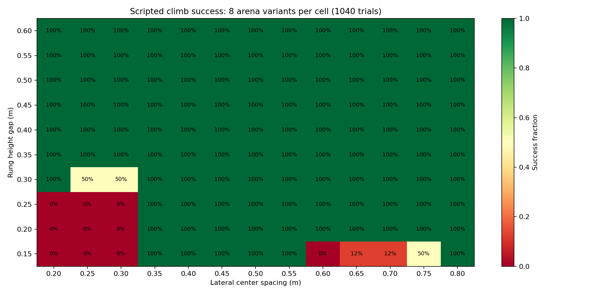
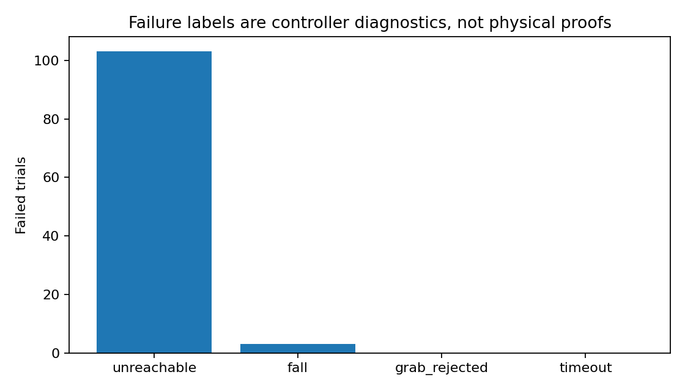

# 第 2 层准备：静态横档可解性扫描

## 结论与实验边界

2026-11-09，Unity 6000.3.24f1 Windows 独立包：130 个参数组合 × 8 个场地变体 = **1040 次尝试，934 次成功（89.81%）**。高度差、横向中心间距均以 **0.05 m** 为步长，覆盖 [0.15,0.60] × [0.20,0.80] m。这里测到的是特定几何与脚本策略的经验成功区域，尚未找到身体能力的上限。



- 高差 0.35–0.60、全部已测横距：每格 8/8。
- 高差 0.20–0.25、横距 ≥0.35：每格 8/8；横距 ≤0.30：每格 0/8。
- 高差 0.30：横距 0.25/0.30 为 4/8，其余为 8/8。
- 高差 0.15：横距 0.35–0.55 和 0.80 为 8/8；0.60 为 0/8，0.65/0.70 为 1/8，0.75 为 4/8，其余 0/8。

这些是离散采样点；不能推断点间连续区间全部成功，也不能把失败格当作物理不可达。8 次变体使用固定的场地平移、绕 y 旋转（0、±15、±30 度）与出生 x 偏移 ±0.01 m，并非八个独立随机种子，不能据此宣称高置信度泛化成功率。

## 几何和控制协议

新文件 `Assets/Scripts/Climber/Layer2Prep/PrepWall.cs` 参数化生成墙；`PrepClimbController.cs` 为独立控制逻辑；`PrepExperimentRunner.cs` 负责批量尝试、计数与 CSV。身体、原控制器、现有测试与 ProjectSettings 均不修改。控制策略仅调用 SetHandTarget / SetGrab / ResetBody 和公开状态查询；不直接施力或修改物理组件。

每场地 4 根静态 Box 横档，尺寸 0.50×0.10×0.25 m；第一根顶面 y=1.00，之后顶面 y=1+i·h，左右中心 x=±s/2。平台顶面 y=1+4h，前缘 z=0，尺寸 2.00×0.20×1.50 m；目标中心相对平台顶面 (0,0.60,0.60)，尺寸 (0.80,0.40,0.60) m。到达要求躯干中心在区域内连续 0.30 s 且速度 <0.50 m/s，含双手撑起与越过边缘。场地中心间距 7 m，支持旋转和平移。所有 Collider 显式使用静/动摩擦 0.15、Average、弹性 0 的材料。

控制频率为每 5 个物理步一次（fixedDeltaTime≈0.02 s），执行撤离、抬高、插入、落手、抓握、左右交替、抓顶部与撑起。支撑努力值 0.70，自由手 1.00；沿用 450/40 N 限幅。每次最长 45 s 模拟时间。失败或成功后记录完整逐场地数据，不以批次总数替代个体结果。

## 用时、负载与失败

成功尝试用时中位数 **10.8 s**，范围 **10.3–18.3 s**（模拟时间）。全部尝试采样到的肩部约束负载峰值 **64.927430 N**，主动力峰值 **315 N**。主动力与关节约束反力分别记录，不能相加或互相替代；峰值在决策采样时读取，肩部状态提供累积峰值，主动力采样可能漏掉物理子步瞬时峰值。这不是断裂强度专项试验。



| 终止分类 | 次数 | 判定意义 |
| --- | ---: | --- |
| unreachable（够点停滞） | 103 | 当前阶段 >8 s，原始目标超出 0.855 m 且手速度 <0.08 m/s 持续 3 s；是策略姿态停滞标签 |
| fall（掉落/失去支撑） | 3 | 躯干 y <−0.25，或曾抓住后双手均失去抓握 |
| grab_rejected（抓握被拒） | 0 | 目标附近候选拒绝持续 2 s 的终止分类 |
| timeout（超时） | 0 | 达到 45 s 模拟时间 |

分类互斥，按首次满足的终止条件记账；0 次“抓握被拒终止”不等于过程中从未出现候选拒绝。103 次停滞发生于：首横档抬高 48、首横档插入 13、第三横档抬高 22、第三横档撤离 4、第四横档撤离 4、顶部左手过渡抬高 12。另 3 次首横档丢支撑。

窄间距/小高差存在几何拥挤线索：横档半宽 0.25 m，加手半径 0.10 m，按中心抓点路径计算约需 0.35 m 横向净避让；当下一横档较低时，其下表面可能挡住上抬/插入路径。但这只是几何解释与日志的一致性，尚未通过碰撞接触轨迹或替代路径对照确认。脚本始终偏好固定抓点和阶段路线，没有搜索外侧边缘、换支撑姿态或恢复动作。尤其 0.15 行的非单调失败，不能据此判定身体做不到。

本轮不修改策略来追求全绿，也不修改身体参数。后续应单独比较外侧抓点/路径规划、更多随机布局与手动证明，且保持原始扫描可复现。建议首批生成使用已测的 h=0.20–0.40、s=0.35–0.60 离散组合，从基准 (0.25,0.40) 起步；不要把“间距更小”直接定义为更容易。

## 复现与数据

先关闭 Unity 编辑器，再运行：

```powershell
.\scripts\build_layer2_prep.ps1
python scripts/run_layer2_prep.py validate
python scripts/run_layer2_prep.py scan
conda run -n mlagents python scripts/analyze_layer2_prep.py
```

打包场景 `Assets/Scenes/Layer2Prep.unity` 是实验入口；独立文件 `Builds/Layer2Prep/Layer2Prep.exe`。原始运行输出在忽略的 `results/layer2/`；归档 [1040 条试验](data/layer2/scan_trials.csv)、[130 格汇总](data/layer2/scan_cells.csv)、[元数据](data/layer2/scan_metadata.json)。扫描源版本 `511855571ef270d733a749eba2b61f915021dda3`。同一物理设置下不保证跨机器逐位确定性。固定四横档导致总攀爬高度随 h 改变，这是本实验的混杂因素。

自定义单组参数可直接调用独立包（scan 模式使用固定全网格，validate 模式才读取这两个参数）：

```powershell
.\Builds\Layer2Prep\Layer2Prep.exe -batchmode -nographics -logFile results/custom-wall.log --prep-mode validate --prep-count 8 --prep-height 0.30 --prep-spacing 0.50 --prep-output results/custom-wall
```

validate 中任一场地失败会返回非零退出码；具体原因查看输出 trials.csv。scan 模式允许记录失败组合后继续扫描，因此失败样本不导致整个进程失败。
