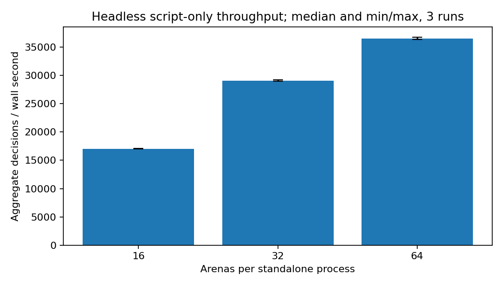

# 第 2 层准备：无图形环境吞吐量

## 实测结果

2026-11-09，在打包后的 Windows64 `Builds/Layer2Prep/Layer2Prep.exe` 使用 `-batchmode -nographics`，GraphicsDevice=Null。CPU Intel Core Ultra 9 285K（24 逻辑处理器），约 32 GiB 内存，Unity 6000.3.24f1。没有连接 Python trainer，没有训练模型。

每档场地数量串行独立启动 3 次，每次预热 3 s、测量至少 12 s 墙钟时间。决策周期 5 物理步，fixedDeltaTime≈0.02 s，运行时 timeScale=100、关闭 VSync、无目标帧率限制。未改 ProjectSettings。每场地使用 (h,s)=(0.25,0.40)，脚本完成后通过身体接口重置并继续攀爬，计时包含控制、碰撞、关节和重置；没有用已完成且闲置的身体测虚高吞吐。



以下为三次中位数；总物理步 = 全局物理 tick × 场地数，总决策步 = 所有场地控制器实际调用次数。

| 场地数 | 全局物理 tick/s | 总物理步/s | 总决策步/s | 决策吞吐 min–max | 变异系数 |
| --- | ---: | ---: | ---: | ---: | ---: |
| 16 | 5,325.7 | 85,210.7 | 17,043.2 | 17,024.5–17,068.4 | 0.13% |
| 32 | 4,544.9 | 145,438.1 | 29,087.6 | 28,998.6–29,244.8 | 0.43% |
| 64 | 2,853.2 | 182,606.2 | 36,521.2 | 36,377.0–36,755.6 | 0.52% |

三档测量窗口分别完成 5,952、10,240、13,056 个回合，全部成功；窗口起止可能包含跨预热边界的回合。64 场地总决策吞吐约为 16 场地的 2.14 倍，但单场地推进速率下降；该实验只证明已测三档中 64 总吞吐最高，不能宣称它是全局最优场地数。

## 第 3 层预算估算

按“所有 Agent 合计决策次数”计步，公式 T=D / 实测总决策步率。这里的决策是每 5 物理步的脚本命令更新；未来 ML-Agents 必须使用同样计步语义才能直接比较。

| 场地数 | 500 万决策步 | 2000 万决策步 |
| --- | ---: | ---: |
| 16 | 4.89 分钟 | 19.56 分钟 |
| 32 | 2.86 分钟 | 11.46 分钟 |
| 64 | 2.28 分钟 | 9.13 分钟 |

这是当前静态环境、脚本控制路径下的环境侧预算参考，不能作为实际 PPO 完成时间承诺。未包含网络推理、Unity/Python 通信、观察编码、GPU/CPU 梯度更新、日志和 checkpoint；第 3 层动态物体、结构数量、回合长度、碰撞密度也会改变吞吐。不能凭此随意乘一个没有实测依据的“训练系数”。建议进入训练时做同一配置的短 PPO pilot，再用 trainer 端实际 step 增长率预算；本轮按要求未训练模型。

## 复现与限制

```powershell
# 先关闭 Unity 编辑器
.\scripts\build_layer2_prep.ps1
python scripts/run_layer2_prep.py throughput
conda run -n mlagents python scripts/analyze_layer2_prep.py
```

默认每档 3 次；具体 CLI 参数见 `python scripts/run_layer2_prep.py --help`。独立进程串行运行，避免同机并行争抢 CPU。三次窗口短、同机同日，未隔离操作系统后台负载、功耗与温度；这是指定 timeScale=100 的应用吞吐，不是硬件绝对最大能力。启动、构建、预热不计入表中速率。图中误差线为 min/max，不是置信区间。

[完整九次元数据](data/layer2/throughput_trials.json) 包含实际计数、时长、Unity/CPU/图形设备和源码版本；[汇总](data/layer2/summary.json)。源码版本 `511855571ef270d733a749eba2b61f915021dda3`，原始日志在 `results/layer2/throughput/`。
