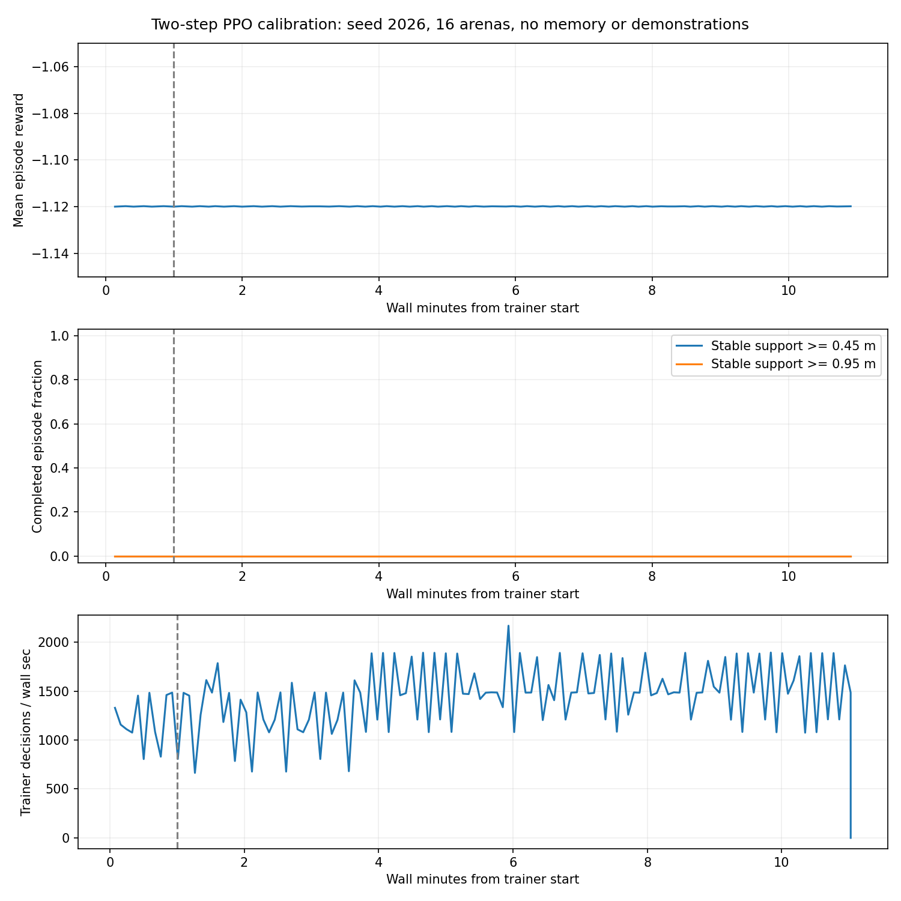

# 第3层：两级台阶PPO校准报告

## 范围与实现

按已确认修改更新[LAYER3_DESIGN.md](LAYER3_DESIGN.md)：抓握为状态意图，1希望保持/尝试抓握，0希望松开；断裂后必须先0再1，不自动重武装。首版无循环记忆，固定自由手努力1.0、抓握手0.7。示范状态初始化为后续主要手段，BC为对照；本轮均未实现或启用。正式多种子实验仍须先冻结每难度至少50个几何独立结构，本轮固定关卡校准豁免。

新增`Assets/Scripts/Learning/`实现Agent、局部感知、Academy时钟与回合日志；Editor生成`Assets/Scenes/ClimbTraining.unity`与Windows包`Builds/Climb/Climb.exe`，包含16个间隔14m的相同两级场地。仅通过SetHandTarget、SetGrab、ResetBody及公开状态查询操作身体，没有新增施力路径。身体、旧控制器、生成器和ProjectSettings均未修改。

动作6连续+两个大小2的离散分支；观察327维；每5个物理步决策，TakeActionsBetweenDecisions=false，增量最大0.08m/决策。努力值每物理步按抓握状态选择，仍经过原渐变与限幅。默认物理步长不变；SDK MaxStep=0，任务自行处理60s/600次决策的失败终止。

奖励为成功+1、失败-1、时间-0.0002/决策、首次更高稳定支撑+0.1（总额≤0.3）；五点向下支撑查询、速度/停留时间门槛和回合去重防止反复刷奖励。登层率是已完成回合中稳定支撑高度达到≥0.45m/≥0.95m的累计比例，不把它当观察或奖励层号，也不等价于依次访问每一个台面。

## 验证

- Unity batchmode编译与Windows构建零错误。
- PlayMode **47/47通过**：原有42项不改，新增目标球壳、327维有限范围、平移/yaw局部观察、抓握状态/增量只积分一次、登层奖励去重5项。[测试XML](data/climb-pilot/tests.xml)。
- 打包预检运行650个决策轮，接口确认为327观察/6连续/[2,2]分支；16个零动作完整回合均约-1.12000003，符合超时及时间成本。[预检](data/climb-pilot/preflight.json)。
- 测试曾发现旋转加载后初始手姿与未旋转加载不同；等价性测试通过公开ResetBody设置同一状态后通过，并避免射线恰好落在几何边界。试跑只用identity场地朝向，不受该加载差异影响；本轮未修改旧加载器或据此宣称旋转初始化问题已修复。

## 试跑条件

run-id=`climb_pilot_s2026`，seed=2026；Unity6000.3.24f1、ML-Agents包4.0.0、Python mlagents1.1.0、PyTorch2.7.1+cu128。GPU为RTX5080；CPU为Core Ultra9 285K。一个无图形Unity进程、16场地，timeScale=100；不是16个独立结构。

网络为2×256前馈，normalize=true，无memory。PPO batch=1024、buffer=16384、3epochs、lr=3e-4、beta=0.005、epsilon=0.2、lambda=0.95、gamma=0.995、horizon=128，调度常数。全部正常底部出生，无示范状态初始化、BC、GAIL或课程切换。试跑中未修改动作、奖励、模型或身体参数。

## 训练端真实吞吐和更新成本

预算请求660秒；下一安全trainer边界停止于 **661.595秒（11.03分钟）**，模型保存完毕约663.867秒。Trainer实际处理 **949,616个Agent决策步**，不是全局物理tick。前60秒预热，之后测量窗口601.595秒。

| 指标 | 实测 |
| --- | ---: |
| 预热后端到端训练率 | **1,461.10决策步/墙钟秒** |
| 全程完整PPO更新 | 55次 |
| 测量窗口完整更新 | 51次 |
| 每次完整更新耗时P50 / P95 | **1.630 / 2.198秒** |
| 窗口内完整更新总耗时 | 87.646秒 |
| 相邻更新间非优化阶段墙钟P50 | 9.615秒 |

计数来自trainer的实际trajectory处理步数；60秒起点使用邻近采样插值，原始数据保留。更新计时包围完整_update_policy，前后CUDA同步，含全部epoch/minibatch，不是单次梯度步。非优化阶段包含样本收集、通信、排队、日志和checkpoint等，不能当纯Unity物理耗时。计时同步和监测本身也有开销。

按此单场景短窗口率，500万/2000万在线决策约57.0/228.1分钟；这不是正式多seed总预算或保证，未含正式评估/示范/其他难度成本。不能沿用第2层纯脚本3.65万步/秒估算实际PPO训练。

## 显存与内存口径

| 指标 | 实测峰值 |
| --- | ---: |
| PyTorch已分配张量显存 | **46.06 MiB** |
| PyTorch缓存保留显存 | **60.00 MiB** |
| 训练Python进程RSS | **1,873.59 MiB** |
| 整卡总占用（首采样 / 峰值） | 3,691 / 3,829 MiB |

PyTorch数字不包含全部CUDA上下文/驱动等开销；整卡数字还包含桌面和其他进程，不能称训练进程独占显存。本机WDDM逐进程nvidia-smi显存查询返回N/A，因此不虚构独占显存数。每5秒记录的整卡利用率也会漏掉短更新峰值，不据此单独判定瓶颈。

## 奖励曲线与每级登层率

虚线为预热结束。奖励纵轴使用绝对值，不放大约0.0002量级的时间计数差异。

| 已完成回合指标 | 结果 |
| --- | ---: |
| 完整回合数 | **1,584** |
| 平均回合奖励 | **-1.119902，约-1.12** |
| 一级累计稳定登层率 | **0%（0/1,584）** |
| 二级累计稳定登层率 | **0%（0/1,584）** |
| 最终成功率 | **0%** |
| 超时 / 其他失败 | 1,584 / 0 |

每分钟一级/二级登层率均0，奖励曲线无实质改善；极小波动来自物理时钟/决策相位导致的599或600次时间扣分，不是进展奖励。没有一级样本，不能估计“已上一级后到二级”的条件成功率。记录的是训练时采样动作表现，不是冻结checkpoint的确定性独立评估。

校准链路有效、吞吐和显存/更新成本已测得，但本次未学会第一层。不能据此认定物理不可解、证明示范状态初始化有效，或保证延长预算就会学会。按用户范围到预算即停止，没有追加示范、改奖励或改身体。正式泛化实验的≥50结构/难度和多seed/多checkpoint评估尚未实施。

## 日志、停止与复现

`scripts/climb_pilot.py`在内存中包装本机PPOTrainer的advance/_update_policy测量，不编辑安装包或优化算法；预算通过KeyboardInterrupt让trainer走保存路径。日志明确记录预期interrupted并导出最终模型，不当成学习异常。PowerShell封装收到Python弃用警告时有NativeCommandError/外层非零状态；没有Python训练异常堆栈，不声称外层shell退出码为0。以budget_stop、finish和模型导出三项证据核验完成。

正式运行前的监测脚本缺少可选psutil时已改为Windows标准API，不安装/升级环境；该次启动尚未进入trainer，不计入本试跑。

模型、TensorBoard事件及完整本机日志仍在忽略的results目录：`results/climb_pilot_s2026/Climb.onnx`、`results/climb_pilot_s2026/Climb/`、`results/climb-pilot-console-s2026.log`。已保存25/50/75万附近与最终checkpoint；本轮不从中挑选测试最佳模型。

可审阅归档：[测量原始JSONL](data/climb-pilot/measurements.jsonl)、[汇总](data/climb-pilot/summary.json)、[逐回合CSV](data/climb-pilot/episodes.csv)、[TensorBoard标量](data/climb-pilot/tensorboard_scalars.json)。复现命令见README；分析本次记录可运行`conda run -n mlagents python scripts/analyze_climb_pilot.py`。

编辑器菜单 **Tools → Climb → Build Two-Step Training Scene**，场景`Assets/Scenes/ClimbTraining.unity`；连接trainer再Play。未连接时零动作Heuristic只用于接口预检，不提供新的手动控制器。
