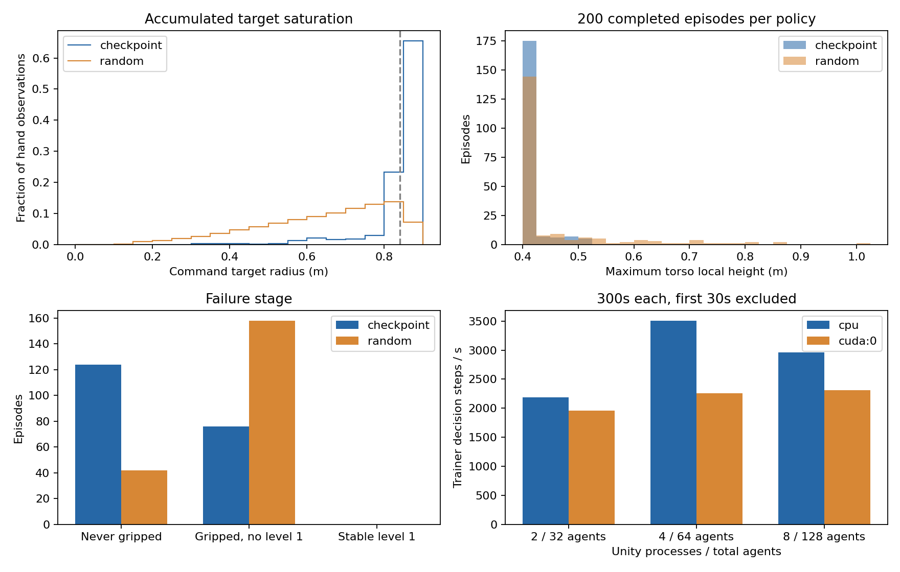

# 第3层：PPO试跑只读诊断

本报告取代此前的草稿`LAYER3_DIAGNOSTICS.md`（已删除）。试跑本身见[LAYER3_PILOT.md](LAYER3_PILOT.md)，设计见[LAYER3_DESIGN.md](LAYER3_DESIGN.md)。

## 0. 范围

只诊断，不修改：ClimberAgent、观察/动作/奖励、身体、原控制器、原测试、ProjectSettings和`config/climb_pilot.yaml`均未改动。新增内容只有被动观测器、独立诊断场景/构建和Python测量工具。没有实施示范状态初始化、BC、中间奖励或动作表示调整。`docs/data/climb-diagnostics/summary.json`的`protectedHashes`记录了30个受保护文件的SHA-256，提交前复核与当前内容一致。

回归：`scripts/test_climb.ps1`（Unity编辑器关闭，batchmode）编译/构建零错误，PlayMode **47/47通过**，[测试XML](data/climb-diagnostics/tests.xml)。该脚本会经Editor脚本重新生成`ClimbTraining.unity`；重新生成的文件除fileID与对象顺序外逐行一致，因此保留已提交版本，避免无意义差异。

## 1. 复现

| 步骤 | 命令 |
| --- | --- |
| 诊断构建（先关闭编辑器） | `.\scripts\build_climb_diagnostics.ps1` → `Builds/ClimbDiagnostics/ClimbDiagnostics.exe` |
| 行为诊断（各200回合） | mlagents环境：`python scripts/climb_behavior_diagnostics.py` |
| 吞吐六组（顺序，各300秒） | `python scripts/run_climb_benchmarks.py`（调用`climb_benchmark_worker.py`） |
| 归档、汇总与作图 | `python scripts/analyze_climb_diagnostics.py` |

- 诊断场景由`ClimbDiagnosticsBuild`从原`ClimbTraining`场景生成：16个原样场地，每个只追加一个只读的`ClimbDiagnosticsObserver`（执行顺序在身体之后，50Hz采样，不写身体或Agent状态；唯一的非公开读取是通过反射取SDK的episode ID来连接记录）。
- 吞吐测试使用原`Builds/Climb/Climb.exe`，不使用诊断构建。
- 原始数据：[行为逐回合数据](data/climb-diagnostics/)（`checkpoint/`、`random/`下的`episodes.json`/`episodes.csv`/`runtime.csv`）、[吞吐原始记录](data/climb-diagnostics/benchmarks/)（每组`measurements.jsonl`、`command.json`、`console.txt`，以及`manifest.json`）、[汇总](data/climb-diagnostics/summary.json)、[图](images/climb_diagnostics.png)。

## 2. 行为诊断

### 2.1 条件

- 策略：试跑最终checkpoint（949,616步）`results/climb_pilot_s2026/Climb.onnx`，SHA-256 `65c8762f249db1a39459e0a0240f1f20a47cd9c51a0aad3e711816722ac7adab`。读取ONNX的deterministic连续/离散输出，CPU推理；归一化包含在导出模型中。
- 对照：6维独立Uniform[-1,1]连续动作，两手独立Bernoulli(0.5)抓握请求，经过同一Agent限幅。它是均匀随机动作，不是随机初始化的PPO网络。
- 两组seed=2026，各取最先完成的200个终止回合，丢弃末尾未完成的回合。全部从墙底正常出生。
- 16个场地是同一几何的平移副本。200回合只能诊断这一个固定关卡上的行为，不是200个独立结构的泛化评估。

### 2.2 计数口径

- **请求输出数**：每次决策每只手输出1计一次，持续保持1每次都计，每回合最多1200次。另计false→true上升沿。
- **抓握成功数**：50Hz采样下Grabbed的false→true次数。同一只手重新抓住会再计一次，所以不是不同物体的个数。
- **拒绝数**：请求为1、未抓住、且不处于冷却或重新武装阻塞时，用公开的`GetGripCandidate`查询拒绝原因，按“手×物理采样”累计。持续1秒没有接触最多计50次，不是50次独立尝试。冷却和NeedsRearm单列。在同一个tick内出现又消失的事件可能漏采。
- **手目标**：累计命令q（观察中的命令目标×0.9m），不是增量动作。半径限制0.15–0.85m；≥0.84m记为外边界，≤0.16m记为内边界。另记身体滤波后PD目标（`TargetOffset`）的外边界比例。
- **高度**：训练场局部坐标下的躯干高度，出生约0.400m。“稳定登层”沿用Agent原有的五点支撑、速度和停留时间判定，瞬间越过某个高度不算。

### 2.3 结果（各200回合）

| 指标 | 最终checkpoint（确定性） | 随机动作 |
|---|---:|---:|
| 从未抓住 | **124（62%）** | 42（21%） |
| 抓住过但未稳定登第一级 | **76（38%）** | 158（79%） |
| 稳定登第一级 / 第二级 / 成功 | 0 / 0 / 0 | 0 / 0 / 0 |
| 终止原因 | 200超时 | 200超时 |
| 抓握成功总数；每回合均值/中位/P95 | 162；0.81 / 0 / 4 | 1891；9.46 / 5 / 34.2 |
| 每回合请求输出1次数（均值） | 692.5 | 599.9 |
| 每回合请求上升沿（均值） | 62.5 | 299.8 |
| 首次抓握时间 均值/中位/P95（秒，仅抓住过的回合） | 26.8 / 25.7 / 37.2 | 19.0 / 14.2 / 51.7 |
| 每回合至少一只手抓住的时长（均值，全部回合） | 8.20秒 | 1.80秒 |
| 同上，仅抓住过的回合 | **21.6秒** | 2.27秒 |
| 抓住期间躯干最高高度：均值 / 最大（仅抓住过的回合） | **0.425 / 0.513m** | 0.460 / 0.965m |
| 抓住过的回合中躯干最高>0.6m | **0 / 76** | 21 / 158 |
| 累计手目标半径≥0.84m比例 | **85.98%** | 11.04% |
| 实际PD目标半径≥0.84m比例 | 86.01% | 10.28% |
| 累计手目标半径 均值；P5/P50/P95（m） | 0.828；0.656 / 0.850 / 0.850 | 0.644；0.318 / 0.678 / 0.850 |
| 外边界比例≥50%的回合 | **200 / 200** | 0 / 200 |
| 原始连续输出达到±1截断 | 0.187% | 0% |
| 冷却 / 重新武装阻塞采样（每回合均值） | 2.0 / 0.03 | 23.7 / 0 |

> **口径更正（2026-11-10）**：Agent的Level-2指标曾在"到达终点、成功结束回合，但尚未满足第二级0.3s稳定支撑"时漏计（快照录制中发现，128条专家轨迹全部Success但level2=0）；已改为成功即记Level-2，只改指标，奖励不变。本报告（checkpoint与随机各200回合）成功回合为0，不可能发生漏计，所引用的第二级登层率不受影响。详见[LAYER3_SNAPSHOT_DESIGN.md](LAYER3_SNAPSHOT_DESIGN.md) 8.7。

拒绝原因（全部候选拒绝采样）：

| 原因 | checkpoint | 随机 |
|---|---:|---:|
| NoContact | 597,940（98.29%） | 569,684（98.81%） |
| NotTop | 10,383（1.71%） | 6,767（1.17%） |
| Occupied / TooFast / TopOccluded | 13 / 29 / 0 | 40 / 31 / 5 |

### 2.4 卡点判断

| 卡点 | checkpoint | 结论 |
|---|---|---|
| 从未抓住 | 124/200；拒绝中98%是NoContact | **主要卡点** |
| 抓住但拉不上去 | 76/200；平均抓住21.6秒，躯干只比出生高约2.5cm | **次要卡点，在剩下的回合里是全部失败原因** |
| 上去后掉下 | 0回合稳定登上第一级 | 不存在：策略还到不了这一步 |

- 策略并非不发请求：每回合输出1的次数比随机还多。缺的是“把手移到合法接触位置，并同时发出请求”。冷却、重新武装和遮挡拒绝占比都很小，没有证据支持优先修改这些规则。
- 抓住之后它“抓得久却不动”：抓住时长是随机策略的约9.5倍，但抓住期间躯干高度几乎不变（0/76回合超过0.6m）。随机策略靠频繁抓放（每回合上升沿约300次），抓住时偶尔把躯干带到0.6–0.97m，但同样没有一次满足稳定登层判定。因此随机策略抓住率更高，并不说明它攀爬更有效。
- 没有证据把瓶颈归因于身体拉力不足或“翻越第二级”。

### 2.5 为什么累计手目标贴着伸展边界

**机制（代码事实）**：`ClimberAgent.ApplyCommand`每次决策执行`q ← Project(q + 0.08·clamp(a,1))`。`Project`沿径向把|q|夹到[0.15, 0.85]m。命令在q中累积，没有任何回中项。

1. **边界几乎是吸收态。** q到达0.85m后，任何带外向分量的动作在投影时被截掉，只剩沿球面的切向移动。要离开边界，必须连续输出净内向分量。因此只要策略均值有一个持续不为零的方向偏置，q就会贴边并一直停在那里。零均值的随机游走也有11%的时间处在边界上，说明这个效应来自表示本身。
2. **不是动作被截断。** 原始连续输出只有0.187%达到±1，而目标86%贴边。问题出在积分器加投影，而不是网络输出饱和。所以缩小动作范围或修改截断，未必能解决累计漂移。
3. **checkpoint存在明显的均值偏置。** 两手合并的目标坐标均值为(0.084, 0.084, −0.096)m，随机约为(0.000, 0.131, 0.110)m。全部200回合的贴边比例都≥50%，说明这是稳定模式，不是少数回合。没抓住的回合里z均值为−0.119m。已知结构位于场地+z方向，若躯干出生朝向为identity，这意味着手目标平均指向远离结构的一侧（这一点是推断，没有逐tick核对躯干朝向）。
4. **评估方式可能放大这一现象（推断）。** 这里用的是确定性均值动作，均值偏置每步都被积分。训练时动作是采样的，噪声会部分抵消漂移。训练过程中的贴边比例没有记录，所以无法确认训练分布中是否同样严重。这一点需要在后续对照中直接测量。
5. **为什么策略会学成这样（推断，无直接证据）。** 试跑只有约95万步，奖励只有时间成本和终点/进展奖励，而进展奖励从未触发，回报几乎恒定在−1.12。连续动作的均值缺乏任何有方向的梯度信号，一个随意的偏置不会被纠正。积分表示又会把这个偏置放大成“手臂一直伸直”的姿态。

> **更正（第5节补充测量）**：下面“伸直手臂不能把躯干拉向握点”的机制已被抓握期间的直接测量修正。抓握点全部位于肩部下方，真正的原因是目标方向向上，把躯干压向地面，而不是半径本身。以第5节为准，下文保留为原始推断。

**与“抓住后不拉升”的关系（原始推断）：**

- **控制语义（代码事实）**：q是肩部相对的手目标。手被抓握锚定后，PD控制器试图让“手相对肩”的位置等于q。q在0.85m（手臂完全伸直）时，控制器做的是把肩部推离或吊在锚点下方，而不是把躯干拉向锚点。拉升必须把|q|沿握点方向缩短到明显小于当前臂长。从0.85m缩到约0.45m，在最大速率0.08m/决策下至少需要连续5次方向一致的内向决策，而策略的偏置恰好是外向。
- **数据支持**：checkpoint抓住过的76个回合中，回合级贴边比例为82.9%，平均抓住21.6秒，抓住期间躯干最高均值只有0.425m。随机策略贴边只有约11%，抓住期间躯干最高可达0.965m。
- **证据边界**：贴边比例是整回合统计，没有单独记录“抓住期间”的目标半径，也没有记录关节内力。因此“贴边导致不拉升”是与数据一致的机制解释，还不是因果证明。下一步对照（第4节第2项）应补记抓住期间的|q|、q与握点方向的夹角，以及抓住期间躯干的竖直位移。
- **同一偏置也解释了“从未抓住”的一部分**：手停在球面上，只沿切向移动，难以把手停在结构顶边上。但拒绝98%是NoContact，也可能只是策略没学会朝结构移动，这两者目前无法区分。

## 3. 吞吐

### 3.1 协议

- “实例”指一个独立Unity进程，每个进程16个场地，因此2/4/8实例共有32/64/128个Agent。
- 每组用新的run-id从头训练300秒，不从试跑checkpoint续训，六组顺序运行（2026-11-09 19:03–19:34本地时间）。
- 原`config/climb_pilot.yaml`不变（2×256，batch 1024，buffer 16384，3 epoch，lr 3e-4，gamma 0.995，horizon 128，timescale 100，seed 2026）。命令行只改变torch-device、num-envs、端口、run-id和日志目录；torch线程数为4。
- 计时从trainer第一次advance开始，排除Python导入和Unity启动。达到300秒后在下一个安全的trainer边界停止并保存，不会打断一次PPO更新。剔除前30秒预热，30秒处的步数用相邻5秒采样插值。步率是trainer统计的所有Agent决策步之和，不是物理tick。
- 更新耗时包住完整的`_update_policy`（全部epoch/minibatch），GPU组在前后做CUDA同步。“收集时间”指上一次更新结束到下一次更新开始的墙钟时间，包括推理、通信、轨迹处理和日志。
- **设备校验**：安装版ML-Agents 1.1在导入时就设置了CUDA全局默认设备，后面指定CPU时，在PyTorch 2.x下没有完全撤销。worker在创建模型前把torch默认设备显式设为所请求的设备，并在第一次advance时断言actor和critic的参数都在该设备上。六组的`start`记录分别为`["cpu"]`或`["cuda:0"]`。没有修改安装包或超参。
- **完整性**：六组的退出码均为0，都有`budget_stop`和`finish`记录；Unity连接数分别为2/4/8；控制台日志中没有error或traceback。

### 3.2 结果

| 组 | Agent数 | 预热后步率（决策步/秒） | 计时窗口内更新次数 | 更新耗时 P50 / P95（秒） | 实际更新buffer 最小/均值/最大 | 更新耗时占窗口 | 收集期步率（buffer均值/收集P50） | 进程RSS峰值 |
|---|---:|---:|---:|---:|---:|---:|---:|---:|
| CPU/2 | 32 | 2,191 | 35 | 2.745 / 2.931 | 17,120 / 17,247 / 17,792 | 36% | 3,270 | 650 MiB |
| GPU/2 | 32 | 1,955 | 31 | 2.119 / 2.476 | 17,120 / 17,261 / 17,792 | 24% | 2,640 | 1,872 MiB |
| **CPU/4** | 64 | **3,509** | 55 | 2.101 / 2.294 | 16,464 / 17,415 / 18,432 | 43% | 6,165 | 665 MiB |
| GPU/4 | 64 | 2,257 | 36 | 2.080 / 2.224 | 16,464 / 17,376 / 19,824 | 28% | 3,118 | 1,892 MiB |
| CPU/8 | 128 | 2,964 | 45 | 2.639 / 2.889 | 16,464 / 17,755 / 19,840 | 44% | 5,226 | 685 MiB |
| GPU/8 | 128 | 2,309 | 36 | 2.102 / 2.349 | 16,464 / 17,756 / 19,824 | 28% | 3,282 | 1,940 MiB |

- GPU组的PyTorch显存峰值为已分配46.1 MiB、保留60 MiB，三组相同。
- 实际buffer大于16,384，因为trainer按整段轨迹（最长128步）追加样本，到超过阈值才更新；Agent越多，超出的部分通常越大。
- 参考：单进程试跑（16 Agent，GPU，600秒窗口）为1,461步/秒，更新P50为1.63秒，见LAYER3_PILOT.md。

### 3.3 结论与原因

1. **CPU/4最快**，3,509步/秒，约为单进程试跑的2.4倍。
2. **8实例比4实例慢。** CPU/8比CPU/4慢15.5%（2,964对3,509）；GPU/8只比GPU/4快2.3%（2,309对2,257），基本持平。这说明瓶颈已经转移到CPU资源竞争。
   - 有数据支持：从CPU/4到CPU/8，**更新耗时P50从2.10秒升到2.64秒（+26%）**，收集期步率从6,165降到5,226。更新的工作量几乎没变（buffer均值只多2%），所以同样的PyTorch CPU计算变慢，只能来自外部资源的减少。
   - 推断，未直接测量：8个Unity物理进程和trainer的4个torch线程在同一颗CPU（Core Ultra 9 285K）上争抢核心、缓存和内存带宽。基准没有记录逐进程CPU占用和核心调度，所以“CPU竞争”是与数据最一致的解释，不是测得的结论。若要确认，需要另外记录逐进程CPU占用，或做固定核心亲和性的对照。
3. **GPU在三档实例数下都比对应的CPU组慢**（−11%、−36%、−22%）。
   - 有数据支持：GPU**并没有输在优化更新上**。GPU组更新P50为2.08–2.12秒，不高于CPU组的2.10–2.75秒，更新占窗口比例也更低（24–28%对36–44%）。差距全部在**收集阶段**：GPU组收集期步率只有2,640–3,282，CPU组为3,270–6,165。而且GPU组无论2、4还是8实例，总步率都停在约2,000–2,300，增加Unity进程几乎没有收益。说明瓶颈在trainer端一个不随环境数扩展的串行路径上。GPU进程还额外常驻约1.2 GiB内存（CUDA上下文）。
   - 推断，未做算子级profiling：收集阶段每次环境步都要对少量Agent（每个进程16个）做一次策略前向。在GPU上，每次前向都要承担主机到显存的拷贝、kernel启动和同步，这些固定开销超过了2×256小网络本身的计算量（显存峰值只有46 MiB，说明模型和批量都很小）。CPU上的同一次前向没有这些开销。这个小批量推理延迟的解释与“更新不慢、收集慢、不随进程数扩展”三点一致，但没有直接计时推理调用。
   - 结论：在当前网络规模下，GPU对优化更新只有有限优势（P50最多快约0.6秒），而对每步推理是净损失。只有网络明显变大或使用循环记忆时，才值得重新比较。

**推荐配置：CPU、4个Unity实例（每实例16场地，共64 Agent）。**

按CPU/4的3,509步/秒估算纯训练墙钟时间：

| 在线决策步 | 估算时长 |
|---:|---:|
| 500万 | 5,000,000 / 3,509 ≈ 1,425秒 ≈ **23.7分钟** |
| 2000万 | 20,000,000 / 3,509 ≈ 5,700秒 ≈ **95.0分钟** |

这些估算的限制：
- 只基于一个seed、300秒内的270秒测量窗口，并且是训练最早期（全部回合超时、回合长度固定600决策）。策略开始成功后回合会变短，重置会更频繁，示范状态初始化也会增加恢复开销，实际步率可能变化。
- 不包含启动、checkpoint、评估、示范采集和多seed成本。例如A/B/C三组各5个seed、每个500万步，串行约需15×23.7≈5.9小时。如果同时跑多个训练，会重新出现上面的CPU竞争，不能按单个训练的步率线性叠加。
- 每组只有一个5分钟窗口，结论不能推广为该设备的普遍最优值，也没有做统计检验。并行实例数不同，数据到达顺序也不同，这是资源设置本身带来的影响。

### 3.4 测量说明

- 前一个agent在19:12运行过一次存档脚本（只复制JSON，没有作图），落在GPU/2的计时窗口（19:09:34–19:14:04）内。GPU/2按分钟的步率为1,888 / 1,904 / 1,926 / 1,948 / 2,256，对应的分钟里没有出现下降，估计影响可以忽略。报告中仍保留原数据，没有剔除。
- 一个TensorBoard进程（mlagents环境，端口6006）在全部测试期间一直运行，用户要求保留。它的开销对六组相同。
- 计时同步和每5秒一次的采样本身也有少量开销，六组口径一致。

## 4. 改进方案（按优先级，只写方案，不实施）

每次只改一个变量，使用新的run-id，在相同的在线步预算下与当前基线A比较。课程推进和主评估只看正常底部出生的回合。

### 1. 示范状态初始化（最优先）

- **针对**：“从未抓住”和“抓住但拉不上去”两个卡点。两段都极少出现成功经验，策略从未见过“合法抓住并把躯干拉上第一级”之后的回报。
- **方案**：按设计第10节执行，但状态库要比原设计更靠前。当前策略连第一级都没上过，因此除了第一级到第二级的转换段外，还必须覆盖：首次合法抓握前后（手接近顶边）、刚抓住第一级、第一级起撑中段、刚落稳第一级。
- 正常出生比例始终≥50%，后期示范比例从50%降到20%，最后10%的预算全部正常出生。分开报告正常出生和中间出生的阶段转化率。
- **前置条件**：需要在身体内部新增一个受控的完整快照恢复接口（刚体位姿和速度、手目标和努力值渐变、抓握锚点和关节、请求/重新武装/冷却、奖励去重缓存），须另行批准。控制器不得直接操作Rigidbody或Joint，也不能用瞬移躯干伪造示范状态。恢复后检查穿透、臂长和锚点，并复算观察。
- **验收指标**：正常出生下首次合法抓握率、抓住期间躯干上升量、稳定登第一级比例。

### 2. 手目标表示方式的独立对照

- **针对**：86%的目标贴边，以及由此导致的抓住后不缩臂、不拉升；可能也影响接近阶段。
- **方案**：保持观察（命令目标字段语义改为对应表示下的命令）、抓握请求、努力值、奖励和预算不变，只换动作到目标的映射。从以下选项中选一项对照：
  - (a) 当前方案：增量累计加径向投影；
  - (b) 有界绝对目标：q = Project(r₀ + R·a)，每次决策直接由动作给出肩部局部目标，没有积分状态；仍经过身体原有1.5m/s目标限速；
  - (c) 带泄漏的增量：q ← Project(q + 0.08a − λ(q − q_rest))，均值偏置只会造成有限偏移，不会吸附到边界。
  - 首选(b)对照(a)，因为它从根本上消除了积分漂移，并让“缩臂”成为一步就能表达的动作。(c)作为备选，λ需要预先确定。
- 必须预先计算(b)中“最小有效动作”能否克服重力阈值，并用小动作测试验证（经验规则）。
- **补记指标**：抓住期间的|q|分布、q与握点方向的夹角、抓住期间躯干竖直位移，以及训练期（采样动作）的贴边比例，以检验第2.5节的推断。
- 与第1项正交，可以并行设计，但不能在同一次运行里一起改。

### 3. 抓握相关奖励（仅在1、2之后仍缺少抓握学习时考虑）

- **针对**：接近和合法抓握阶段的稀疏信号。不奖励请求1，不奖励抓握次数。
- **去重规则，以“有效的新支撑”为单位**：
  - 一次抓握只有同时满足以下条件，才算“有效的新支撑”：
    1. 抓握点所属的支撑面（内部支撑ID，不进入观察），在本回合中还没有任何一只手获得过这项奖励；
    2. 抓住并持续保持≥0.3秒，期间没有断裂；
    3. 该支撑的顶面高度不低于本回合已奖励支撑中的最高者，防止回到低处的旧支撑反复领奖。
  - 同一支撑上的松开再抓、换手、两只手先后抓同一边沿、冷却后重抓、跌落后重抓，都不再发奖。
  - 每回合抓握奖励总额设上限，并且低于现有的进展奖励上限（0.30），更远低于终点奖励（1.0）。这样“只刷抓握不攀爬”的策略总回报始终低于真正登层。
  - 奖励计算只读物理状态和公开快照，不改变抓握判定本身。
- **验证**：先用单元测试验证奖励账本：反复抓放同一点、两手互换、松开再抓、跌落后重爬、同高的两个支撑，均不能重复结算。再与原奖励做单变量比较，并检查是否出现“抓住后停着”的刷分行为。
- 若考虑“接近合法抓点”的势函数奖励，必须用势函数差分并处理终止时的势值，并另做一组单变量对照，不与抓握奖励同时加入。

### 4. 行为克隆作为后续独立对照

- **针对**：接近阶段的目标定位，以及抓住后的起撑动作序列。
- 现有脚本能完成两级，但前提是先把专家动作适配到同一套6连续+2离散的动作接口（设计第6节），并接受脚本分布偏差。按既定计划保留为C组对照，不作为补丁临时启用。

### 当前没有优先证据支持的方向

- 循环记忆。
- 增大力量或臂长。
- 修改冷却或重新武装规则：数据中这两类阻塞的采样几乎为0。
- 放宽稳定登层判定。

## 5. 补充测量：抓握期间的目标、臂长与力（验证第2.5节推断）

### 5.1 方法

只修改诊断观测器`ClimbDiagnosticsObserver`（Agent、身体、奖励不变），重新构建诊断包。对每只处于抓握状态的手、每个50Hz物理采样，记录以下量：

| 量 | 定义 |
| --- | --- |
| 命令目标半径\|q\| | Agent私有的命令缓冲，用反射只读，从不写入 |
| PD目标半径 | 身体滤波后的目标`TargetOffset` |
| 手到肩的实际距离 | `ArmLength` |
| 超出量 | \|q\|减实际臂长 |
| 主动力F | 作用在手上的力，记录大小，以及在躯干坐标中的分量 |
| 手相对肩的位置r | 躯干坐标 |
| 拉力分量 | 躯干在肩部受到的力（−F）沿肩→手方向的分量，正值表示把躯干拉向握点 |
| 躯干竖直受力 | −F_y，正值向上 |

另外按\|q\|分为<0.60 / 0.60–0.84 / ≥0.84m三档，分别累计拉力分量、躯干竖直受力和躯干竖直速度。

用试跑checkpoint（确定性输出）重跑50回合，并用均匀随机动作跑50回合作对照，seed=2026。命令：
`python scripts/climb_behavior_diagnostics.py --episodes 50 --output results/climb-grip-diagnostics`，然后运行`python scripts/analyze_grip_diagnostics.py`。数据见[climb-grip-diagnostics](data/climb-grip-diagnostics/summary.json)。

观测器同时新增了“合法接触”计数：未抓握的手在某个物理采样上，公开的`GetGripCandidate`返回Allowed（不论是否发出请求），就记一次合法接触。第3步的对照实验也使用这个口径。

### 5.2 结果

| 抓握期间（逐手×物理采样） | checkpoint | 随机 |
|---|---:|---:|
| 抓住过的回合 | 22/50 | 37/50 |
| 抓握手采样数 | 20,721 | 4,335 |
| 命令目标半径均值；≥0.84m比例 | **0.845m；96.8%** | 0.669m；12.7% |
| PD目标半径均值 | 0.845m | 0.643m |
| 手到肩实际距离均值 | 0.761m | 0.624m |
| 目标超出实际臂长（均值） | **+0.084m** | +0.045m |
| 主动力大小均值（抓握预算0.7×450=315N） | **264N** | 73N |
| 手上的力，躯干坐标(x, y, z) | (−17, **+219**, −31)N | (0, −46, −1)N |
| 躯干竖直受力（−F_y） | **−219N（向下，约1.9倍体重117.7N）** | **+46N（向上）** |
| 拉向握点分量 | +86N | −8N |
| 手相对肩，躯干坐标(x, y, z) | (0.13, −0.14, 0.41)m | (−0.05, −0.10, 0.48)m |
| 手低于肩的采样比例 | **100%** | 100% |
| 抓住期间躯干最高>0.6m的回合 | 0 | 6 |
| 未抓握手的合法接触率；出现过合法接触的回合 | 0.13%；42% | 2.04%；74% |
| 全回合命令目标≥0.84m比例 | 85.2% | 11.0% |

按命令目标半径分档：

| \|q\|分档 | checkpoint：采样占比 / 躯干竖直受力 / 躯干竖直速度 | 随机：采样占比 / 躯干竖直受力 / 躯干竖直速度 |
|---|---|---|
| <0.60 | 0.6% / −176N / 0.000m/s | 30.9% / +27N / +0.007m/s |
| 0.60–0.84 | 2.6% / −147N / 0.000m/s | 56.4% / +52N / +0.061m/s |
| ≥0.84 | 96.8% / −222N / 0.000m/s | 12.7% / +65N / +0.063m/s |

### 5.3 结论

1. **“抓握期间目标贴在伸展边界”得到证实，而且比全回合统计更严重**：抓握时96.8%的采样贴边，全回合为85%。命令目标比实际臂长多出约8cm，PD力接近预算（264/315N）。
2. **“伸直手臂不能把躯干拉向握点”的机制需要更正。** 抓握点100%在肩部下方，平均在肩前0.41m、肩下0.14m，即低台阶的顶边。对一个低于肩部的握点，把躯干拉向握点等于把躯干往下拉。拉起躯干需要的是把手目标指向握点下方或肩部一侧（“下压撑起”），使身体对手施加向下的力，反作用力向上推躯干。
3. **checkpoint的实际行为是：抓住低台阶后，把目标推到肩部斜上方的边界，用约1.9倍体重的力把自己压在地上**（躯干竖直速度≈0）。随机动作抓握时躯干平均受到+46N的向上力，最高能达到1.0m。
4. **半径本身不是因果变量，方向才是。** 随机动作在≥0.84m档反而有最大的向上力（+65N）。checkpoint在<0.60m档（样本很少）也仍是−176N。决定能否撑起的是目标相对握点的方向。贴边是“均值偏置朝上外方向”被积分后的结果，是症状而不是原因。
5. **对改进方案的含义**：
   - 第4节第2项（目标表示对照）仍然成立，但理由修正为两点：absolute表示消除了偏置的累积；同时“把目标放到握点下方”只需一步动作就能表达，而在增量表示下要从边界连续反向移动多次。
   - 对照实验应把“抓握期间躯干竖直受力”作为主要的机制指标，与\|q\|并列报告。
   - checkpoint的合法接触率只有0.13%，是随机的约1/16。这说明“从未抓住”这一主要卡点同样存在，目标表示对照也要报告这一指标。
